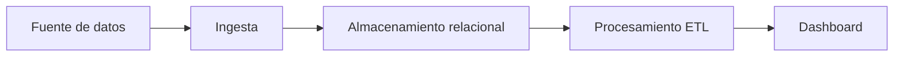
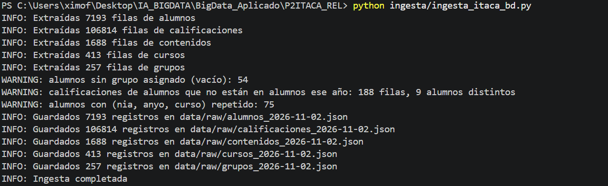
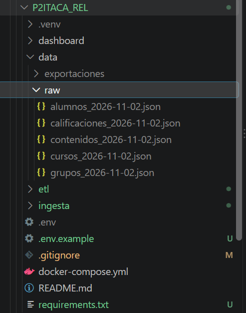
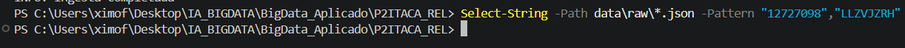

# Proyecto 2: ITACA REL

## Descripción y objetivo

Este proyecto tiene como objetivo organizar el proceso de ingesta y tratamiento de datos relacionados con ITACA en formato relacional. Se preparará un flujo de trabajo para procesar los datos y obtener información útil para su posterior visualización.

## Arquitectura



## Estructura del repositorio

```text
P2ITACA_REL/
├── .env                  (no versionado)
├── .env.example
├── .gitignore
├── README.md
├── docker-compose.yml
├── requirements.txt
├── data/
│   ├── exportaciones/    (SQL de origen, no versionado)
│   └── raw/              (JSON de la ingesta, no versionado)
├── ingesta/
│   └── ingesta_itaca_bd.py
├── etl/
└── dashboard/
```

## Tecnologías

- Python 3.10 o superior (`psycopg2-binary`, `python-dotenv`, `pandas`).
- PostgreSQL 16 en Docker.
- Git y GitHub.
- Herramientas de procesamiento de datos relacionales.

## Fuentes de datos

**Origen.** No se dispone de acceso a una réplica real de ITACA, así que se trabaja con la base de datos de ejemplo proporcionada por el docente: cinco ficheros SQL (`data/exportaciones/`) con los datos del CIPFP Mislata de los cursos 2021-22 a 2025-26, con la misma estructura que el escenario real.

**Mecanismo de acceso.** Los SQL se cargan en una base de datos PostgreSQL 16 (`itaca_academico`) levantada con Docker Compose. El script de ingesta se conecta a ella con `psycopg2` (el equivalente en Python de JDBC) y ejecuta un `SELECT *` por tabla.

**Autenticación.** Usuario `lectura_bigdata`, con permisos únicamente de `SELECT` sobre las cinco tablas. Las credenciales se guardan en el fichero `.env` (excluido de Git). El repositorio incluye `.env.example` con las variables y sin valores.

**Tablas y campos.**

| Tabla | Filas | Campos |
|---|---|---|
| `alumnos` | 7193 | nia, nombre, apellido1, apellido2, fecha_nac, sexo, tipo_doc, documento, nacionalidad, pais_nac, municipio_nac, cod_postal, provincia, municipio, localidad, telefono1-3, email1-2, sip, expediente, ensenanza, curso, grupo, turno, linea, modalidad, repite, estado_matricula, tipo_matricula, matricula_parcial, matricula_condic, fecha_matricula, fecha_ingreso_centro, anyo |
| `calificaciones` | 106814 | evaluacion, alumno, ensenanza, curso, contenido, bloque_contenido, nota_numerica, tipo_nota, anyo |
| `contenidos` | 1688 | codigo, nombre_cas, nombre_val, ensenanza, curso, anyo |
| `cursos` | 413 | codigo, nombre_cas, nombre_val, abreviatura, ensenanza, padre, anyo |
| `grupos` | 257 | codigo, nombre, ensenanza, linea, turno, modalidad, aula, capacidad, anyo |

**Frecuencia de actualización.** Los datos son exportaciones por curso académico, así que se espera una carga por curso (una vez al año, más actualizaciones puntuales si se re-exporta algún curso).

**Relaciones entre tablas** (todas las claves incluyen `anyo`):

- `alumnos.curso` → `cursos.codigo`
- `alumnos.grupo` → `grupos.codigo`
- `calificaciones.alumno` → `alumnos.nia`
- `calificaciones.contenido` + `calificaciones.curso` → `contenidos.codigo` + `contenidos.curso`
- `contenidos.curso` → `cursos.codigo`

## Bitácora de prácticas

### Bloque 1: Ingesta ITACA (BD relacional)

#### Proceso seguido

1. **Entorno.** Se levantó PostgreSQL con `docker compose up -d`, se creó la base `itaca_academico` y se cargaron los cinco ficheros SQL. Se comprobaron los recuentos por año (por ejemplo, 2021: 1341 alumnos y 18906 calificaciones, coincidiendo con los comentarios de los SQL).
2. **Usuario de solo lectura.** Se creó `lectura_bigdata` con `GRANT SELECT` sobre las cinco tablas, y se comprobó que un `DELETE` falla con `permission denied`.
3. **Entorno Python.** Entorno virtual `.venv`, dependencias en `requirements.txt` y configuración en `.env`.
4. **Script de ingesta** (`ingesta/ingesta_itaca_bd.py`). Extrae las cinco tablas, anonimiza, valida y guarda un JSON por tabla en `data/raw/` con la fecha en el nombre.
5. **Ejecución:** `python ingesta/ingesta_itaca_bd.py`.

**Captura 1: ejecución del script (salida por consola).**



**Captura 2: ficheros generados en `data/raw/`.**



**Captura 3: comprobación de que no aparecen datos reales.** Se buscan un NIA y un documento reales de ejemplo en los JSON con `Select-String`, y no hay ninguna coincidencia.



#### Diferencias respecto al enunciado

- El enunciado habla de cinco tablas (Alumnos, Modulos, Calificaciones, Grupos y Horas), pero luego lista cuatro con nombres distintos. La base de datos real tiene cinco: `alumnos`, `calificaciones`, `contenidos`, `cursos` y `grupos`. No existe tabla de horas, y lo que el enunciado llama "módulos" es la tabla `contenidos`.
- Algunas columnas tienen otro nombre: el NIA en `calificaciones` es `alumno`, el módulo es `contenido` y la nota es `nota_numerica`.

#### Decisiones sobre anonimización

- **NIA.** Se sustituye por los 10 primeros caracteres de un hash SHA-256. A diferencia del enunciado, se añade una **sal secreta** (`HASH_SALT`, en `.env`), porque un hash sin sal sobre números de 8 cifras se puede deshacer por fuerza bruta. Cada NIA se calcula una sola vez y se reutiliza, así `alumnos.nia` y `calificaciones.alumno` siguen cruzando. El script comprueba además que no haya colisiones.
- **Columnas eliminadas** de `alumnos`: nombre, apellidos, fecha de nacimiento, tipo de documento, documento, teléfonos, emails, SIP, expediente, código postal, municipio, localidad y municipio de nacimiento.
- **`anyo_nac`.** En lugar de la fecha de nacimiento completa se conserva solo el año, útil para análisis de edad.
- **Datos conservados:** sexo, nacionalidad, país de nacimiento, provincia y fechas de matrícula e ingreso. Son necesarios para el análisis académico. Combinados en grupos muy pequeños podrían identificar a alguien, y es un riesgo residual aceptado en una práctica con datos de ejemplo.
- **Validación antes de guardar.** Si queda alguna columna personal, algún NIA original o algún catálogo es incoherente, el script no escribe ningún fichero.

#### Validación de claves e incidencias en los datos

Las claves entre tablas son coherentes en lo estructural: todo `contenido` referenciado en `calificaciones` existe en `contenidos`, y todo `curso` existe en `cursos`. El script detecta además tres incidencias del dato de origen, que registra como aviso sin detener la ingesta:

| Incidencia | Cantidad | Tratamiento |
|---|---|---|
| Alumnos con `grupo` vacío | 54 (2022 a 2025) | Se conservan. Se decidirá en el ETL si se excluyen o se etiquetan como "sin grupo". |
| Calificaciones de alumnos que no figuran en `alumnos` ese año | 188 filas, 9 alumnos (todas de 2023) | Se conservan. Se revisarán en el ETL. |
| Alumnos con (nia, anyo, curso) repetido | 75 | Posibles matrículas duplicadas. Se revisarán en el ETL. |

Por esto, la comprobación "todo grupo referenciado en alumnos existe en grupos" se cumple para todos los alumnos con grupo asignado: los 54 sin match son precisamente los que tienen el campo vacío.

#### Problemas encontrados

- PowerShell bloquea la activación del entorno virtual por defecto. Se resuelve con `Set-ExecutionPolicy -Scope Process -ExecutionPolicy Bypass`.
- Con `docker exec` no se valida la contraseña (conexión local dentro del contenedor), pero sí desde Python por red. La contraseña del `.env` debe coincidir con la del usuario `lectura_bigdata`.
- Con el contenedor parado el script falla con `Connection refused`: hay que ejecutar `docker compose up -d` antes de lanzar la ingesta.
