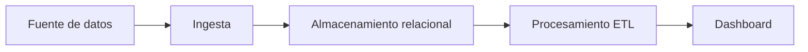

# Proyecto 2: ITACA REL

## Descripción y objetivo

Este proyecto tiene como objetivo organizar el proceso de ingesta y tratamiento de datos relacionados con ITACA en formato relacional. Se preparará un flujo de trabajo para procesar los datos y obtener información útil para su posterior visualización.

## Arquitectura



## Estructura del repositorio

```text
P2ITACA_REL/
├── .gitignore
├── README.md
├── ingesta/
├── etl/
└── dashboard/
```

## Tecnologías

- Python 3.10 o superior.
- Git y GitHub.
- Herramientas de procesamiento de datos relacionales.